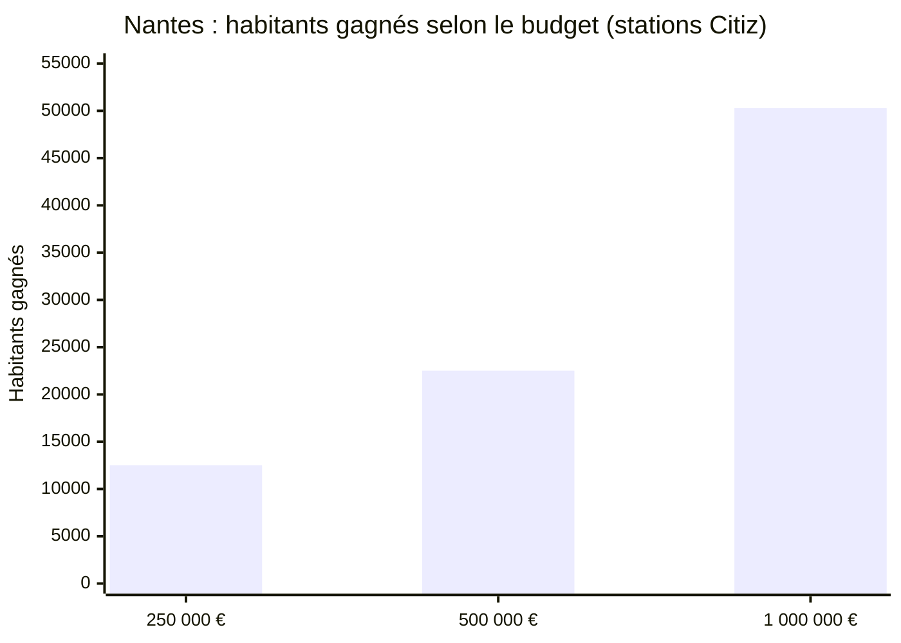
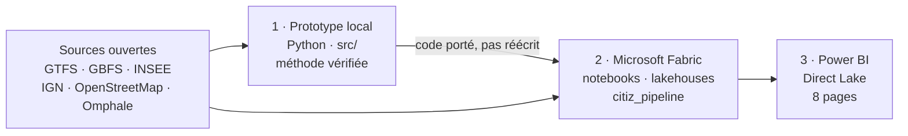
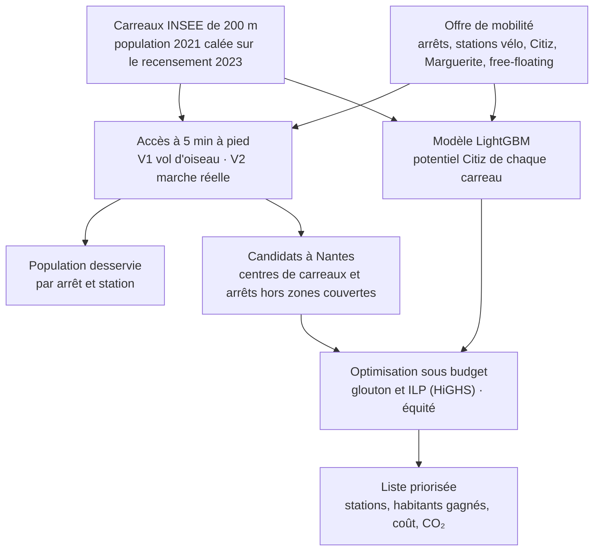
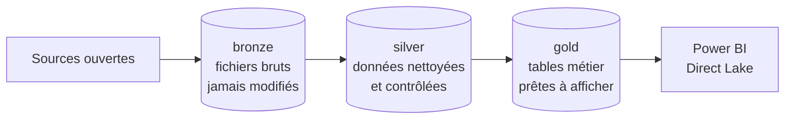
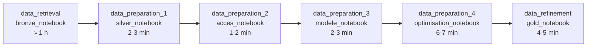
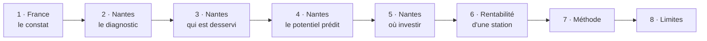

# Hackathon Mobility Citiz

**Epitech × Citiz × Microsoft** · Nantes Métropole · Microsoft Fabric · Power BI

> **Qui a réellement accès à une option de mobilité à 5 minutes à pied, et où faut-il en ajouter ?**

<a href="https://app.fabric.microsoft.com/groups/505711de-ffb1-4f70-a8f3-f5d746623813/"></a>

**Espace Microsoft Fabric « Hackathon Citz »** : pipeline, lakehouses, notebooks et rapport Power BI.
[Ouvrir dans Fabric](https://app.fabric.microsoft.com/groups/505711de-ffb1-4f70-a8f3-f5d746623813/) ou scanner le
QR code (accès réservé aux membres de l'espace).

<br clear="right">

Une option de mobilité, c'est un arrêt de bus, tram ou train, une station de vélos, de la trottinette ou du vélo en
free-floating, ou une voiture Citiz. Le projet répond à trois questions :

| | Objectif | Ce qu'on produit |
|---|---|---|
| **1** | **Accès** | Nombre d'options à 5 min à pied, pour chaque carreau habité de 200 m, en France et à Nantes |
| **2** | **Desserte** | Population servie par chaque arrêt et station, et habitants qui n'ont qu'une seule option |
| **3** | **Investissement** | Liste priorisée de nouvelles stations à Nantes, sous budget, guidée par un modèle prédictif |

---

## Les résultats en un coup d'œil

Nantes Métropole, 5 minutes de **marche réelle** sur le réseau piéton. Source : Microsoft Fabric
([`docs/chiffres_officiels.md`](docs/chiffres_officiels.md)).

| | |
|---|---:|
| Habitants de Nantes Métropole | 689 456 |
| Ont au moins une option de mobilité à 5 min à pied | **80,7 %** |
| Ont un autopartage (Citiz ou Marguerite) à 5 min à pied | **19,0 %** |
| N'ont qu'**un seul** arrêt ou station à 5 min | 107 205 |
| **Avec 500 000 €** : stations Citiz recommandées | **13** |
| Habitants nouvellement à 5 min d'un autopartage | **+22 510** |
| Couverture autopartage, avant → après | **19,0 % → 22,3 %** |
| Coût par habitant gagné (3 ans) | 21,9 € |
| Avec 1 M€ | 26 stations, +50 290 habitants |
| France entière : habitants sans aucune option à 5 min (vol d'oiseau, borne haute) | 24,1 % |



---

## Vue d'ensemble

Le projet s'est construit en trois temps : un **prototype local** pour mettre au point la méthode, son
**industrialisation dans Microsoft Fabric**, puis la **restitution dans Power BI**.



| Ville | Rôle |
|---|---|
| **Nantes Métropole** | **Notre ville** : toutes les recommandations. Citiz y est présent mais peu dense (densification). |
| **Grenoble** | **Ville exemple** : comparaison vol d'oiseau / marche réelle, test à l'aveugle du modèle. |
| **Nice** | **Contre-exemple**, documenté seulement. |

Pourquoi ces villes : [`docs/choix_ville.md`](docs/choix_ville.md) · décisions de l'équipe :
[`docs/decisions.md`](docs/decisions.md).

---

## La méthode



**Accès (objectifs 1 et 2).** Chaque carreau habité compte les options atteintes à 400 m, soit 5 minutes de marche.
Poids : station Citiz ou d'autopartage 1,5 ; arrêt de transport en commun (arrêts fusionnés à 50 m) 1 ; station de
vélos 1 ; opérateur de free-floating présent 0,5 par mode.

| | V1 : vol d'oiseau | V2 : marche réelle |
|---|---|---|
| Calcul | Cercle de 400 m autour du carreau | 400 m sur le réseau piéton OpenStreetMap (Dijkstra) |
| Où | France entière (2,3 M carreaux) | Nantes Métropole (Grenoble en local) |
| Lecture | Borne haute : **+80 % d'options** à Grenoble par rapport à la V2 | Chiffres officiels de Nantes |

**Modèle prédictif.** Un LightGBM apprend, sur tous les carreaux habités de France métropolitaine, où Citiz a déjà une station à
400 m. Ses variables sont la densité de population à 400 m et 1 km, l'offre de transports, de vélos et de
free-floating, la distance au premier arrêt, la part de ménages sans voiture et le niveau de vie. Il est validé
région par région, chaque région étant prédite par un modèle qui ne l'a pas vue, et à l'aveugle sur Grenoble
(AUC 0,935). Pour Nantes, on utilise la probabilité prédite sans avoir vu sa région, afin de ne pas favoriser les
quartiers que Citiz couvre déjà. Détail : [`docs/modele.md`](docs/modele.md).

**Optimisation (objectif 3).** Le score d'un candidat est la population nouvellement desservie à pied, multipliée
par le potentiel prédit, avec un poids d'équité (ménages pauvres, ménages sans voiture). Chaque carreau n'est compté
qu'une fois. Deux méthodes : glouton et ILP optimal (PuLP + HiGHS). Les coûts sont sourcés dans
[`config/costs.yaml`](config/costs.yaml) (scénario moyen, 3 ans).

### Trois choix assumés

- **Aucune donnée de délinquance n'entre dans les calculs.** C'est une donnée sensible : on ne pénalise pas un
  territoire sur ses statistiques de vols. Elle n'est ni variable du modèle, ni surcoût d'une station.
- **Le modèle de prédiction reste à vol d'oiseau, même pour Nantes.** Il apprend sur toute la France, où le réseau
  piéton n'est pas calculé. Lui donner des variables de Nantes en marche réelle fausserait ses prédictions : sur les
  6 739 carreaux de Nantes, le vol d'oiseau compte en moyenne 1,9 fois plus d'options que la marche réelle. Ce choix
  pèse peu : le modèle ne sert qu'à **départager** les emplacements (sa probabilité est rapportée à la moyenne des
  candidats), l'ordre des carreaux reste proche entre les deux mesures (corrélation de rang de 0,82), et **les
  habitants gagnés sont comptés en marche réelle**.
- **Le potentiel des arrêts de bus et des stations de vélos n'est pas prédit** : il vaut 1 pour tous. Seul celui des
  stations Citiz l'est.

Méthode complète : [`docs/methodologie.md`](docs/methodologie.md).

---

## Microsoft Fabric

Le code local a été **porté** dans l'espace Fabric « Hackathon Citz », pour que toute la chaîne se relance depuis
Fabric et non plus depuis le portable d'un membre de l'équipe. Les notebooks tournent en runtime **Python**, pas
Spark : le volume ne justifie pas un cluster, et les traitements clés (Dijkstra, ILP, LightGBM) sont des
bibliothèques Python.

### Architecture médaillon



- **bronze** : les fichiers tels que téléchargés, avec un manifeste d'ingestion.
- **silver** : codes INSEE en texte, carreaux et arrêts rattachés aux communes par contour, dimensions
  `dim_arret`, `dim_station`, `dim_commune`, faits de population et de motorisation, tables de contrôle qualité.
- **gold** : accès par carreau, population desservie, probabilités du modèle, liste priorisée sous budget, coûts,
  projections de population, tables de saisie du rapport.

### Le pipeline `citiz_pipeline`



| Notebook | Lit | Écrit | Rôle |
|---|---|---|---|
| `bronze_notebook` | sources ouvertes | `bronze` | Téléchargement de toutes les sources, France entière |
| `silver_notebook` | `bronze` | `silver` | Normalisation, rattachement aux communes, contrôles |
| `acces_notebook` | `silver`, `bronze` | `gold` | Objectifs 1 et 2 : accès V1 France, **V2 Nantes**, population desservie |
| `modele_notebook` | `gold`, `silver` | `gold` | Modèle LightGBM, validation par région et à l'aveugle, importance des variables |
| `optimisation_notebook` | `gold`, `silver` | `gold` | Objectif 3 : liste priorisée sous budget, projections de population, rentabilité |
| `gold_notebook` | `silver` | `gold` | Indicateurs par commune et score de présélection à 8 critères |

- **Bronze est actif** (choix de l'équipe pour la démo) : une exécution retélécharge toutes les sources (≈ 1 h de
  plus). Pour aller plus vite, le désactiver dans le pipeline : l'activité compte alors comme réussie, et la chaîne
  repart de Silver en 15 à 20 minutes.
- **Nouvelles tentatives** : chaque activité réessaie 2 fois, à 2 minutes d'intervalle, si la capacité Fabric est
  saturée (`TooManyRequestsForCapacity`). Une capacité chargée ralentit aussi les notebooks : ne pas relancer juste
  avant une démo.
- **Paramètres** : les noms de lakehouses (`bronze`, `silver`, `gold`) passés par le pipeline remplacent ceux des
  notebooks. Après une modification dans l'éditeur, cliquer sur **Enregistrer**, sinon l'ancienne version tourne.
- **Traçabilité** : chaque notebook écrit l'identifiant de son run (`_run_id`) dans ses tables et dans la table
  `pipeline_run`. L'étape suivante relit le **dernier run complet** de la précédente : après une modification, on
  relance seulement à partir du premier notebook modifié. Ne jamais relancer une partie de `bronze_notebook` seule.

La définition du pipeline vit dans l'espace Fabric, pas dans le dépôt. Import des notebooks et dépendances :
[`fabric/README.md`](fabric/README.md). Guide complet de l'espace (tables gold, dépannage) :
[« Microsoft Fabric : la chaîne de données Citiz »](https://claude.ai/artifact/D5SvzVHSMucpERt1UgLB4J).

---

## Power BI

`fabric/powerbi/citiz_acces_investissement/` est versionné au format texte (PBIP).

- **Modèle sémantique** (`semantic_model/`, TMDL) : 21 tables `gold_*` en **Direct Lake**. Les données sont lues
  directement dans OneLake, sans import ni rafraîchissement planifié : dès que le pipeline réécrit `gold`, le rapport
  est à jour.
- **Rapport** (`report/`, PBIR) : 8 pages, cartes Azure Maps, segments, tableaux.
- **Simulation de rentabilité** : les tables `gold_saisie_*` servent de champs de saisie libre (investissement,
  véhicules, recettes, charges, durée d'amortissement). Le calcul se fait dans les mesures DAX ; rien n'est enregistré.

### Les 8 pages du rapport

Le rapport se lit comme un récit : du constat national à la décision d'investir à Nantes, puis la méthode et ses
limites. Chaque page rappelle en en-tête la mesure utilisée (marche réelle à Nantes, vol d'oiseau en France).



| Page | Question | Objectif du brief |
|---|---|---|
| 1 · France : accès à 5 min | Qui a une option de mobilité à 5 min à pied en France ? | 1 |
| 2 · Nantes : diagnostic | Où l'accès est-il faible à Nantes ? | 1 |
| 3 · Nantes : qui est desservi | Quels arrêts et stations desservent qui ? | 2 |
| 4 · Nantes : potentiel prédit | Où Citiz s'installerait-il ? | 3 (modèle) |
| 5 · Nantes : où investir | Où investir pour desservir le plus d'habitants au moindre coût ? | 3 (liste priorisée) |
| 6 · Rentabilité d'une station | À partir de combien de réservations une station est-elle rentable ? | 3 (complément) |
| 7 · Méthode et limites | Comment les chiffres sont-ils calculés ? | |
| 8 · Limites | Que ne disent pas les chiffres ? | |

#### 1 · France : accès à 5 min

Le constat national, **à vol d'oiseau** (400 m autour du carreau) : c'est une borne haute, qui surestime l'accès.

- **4 chiffres clés** : habitants (population 2023), options par habitant, part des habitants **sans aucune
  option**, part à 5 min d'une station Citiz.
- **Carte des communes**, du plus froid (bleu, peu d'options par habitant) au plus chaud (rouge). La taille d'un
  point est la population de la commune.
- **Segment Département** (Loire-Atlantique par défaut) et **tableau des communes** : habitants, options par
  habitant, part sans option, part à 5 min de Citiz.

Tables : `gold_acces_commune`, `gold_acces_carreau`.

#### 2 · Nantes : diagnostic

Le même indicateur à Nantes Métropole, mais en **marche réelle** sur le réseau piéton OpenStreetMap.

- **6 chiffres clés** : habitants, options par habitant, part sans aucune option, part à 5 min d'un arrêt de
  transport en commun, d'une station Citiz, et d'un autopartage (Citiz ou Marguerite).
- **Carte des carreaux de 200 m**, colorés par nombre d'options à 5 min de marche. Les carreaux imputés (moins de
  11 ménages) sont masqués, par secret statistique.
- **Classement des communes** par options par habitant.
- **Profil social** de chaque commune (Filosofi 2021) : niveau de vie, part de ménages pauvres, part des 18-24 ans
  et des 65 ans et plus. Il sert à repérer les communes où un manque d'accès pèse le plus.

Tables : `gold_acces_carreau` (colonnes `*_v2`), `gold_acces_commune`.

#### 3 · Nantes : qui est desservi

L'objectif 2 : la population servie par **chaque** arrêt et station.

- **Carte des points d'offre** (arrêts, stations Citiz, Marguerite, vélos, free-floating), colorés par type. La
  taille d'un point est le nombre d'habitants à 5 min de marche.
- **Nombre de points par type**.
- **Tableau des points les plus utiles** : habitants desservis et **« seule option »**, c'est-à-dire les habitants
  pour qui ce point est l'unique option à 5 min. Ce sont les points à ne surtout pas supprimer.
- Les zones desservies se recouvrent : additionner les habitants de plusieurs points compte certains habitants
  plusieurs fois.

Table : `gold_offre_desservie`.

#### 4 · Nantes : potentiel prédit

Le modèle de prédiction : où Citiz s'installerait-il, d'après les quelque 1 600 stations qu'il a déjà en France ?

- **Carte du potentiel Citiz** par carreau, en 5 classes de très faible à très fort (quintiles). Pour Nantes, la
  probabilité vient d'un modèle qui n'a pas vu sa région.
- **Tableau de validation** : AUC et précision moyenne (PR-AUC) du modèle, comparées à celles de la densité de
  population seule, région par région et sur Grenoble à l'aveugle.
- **Importance des variables** (SHAP) : ce qui compte le plus pour le modèle.
- **Encadré « Lecture »** : la densité seule fait presque aussi bien ; le modèle classe mieux le haut de liste et
  fournit le potentiel utilisé page 5.

Tables : `gold_modele_proba_carreau`, `gold_modele_validation`, `gold_modele_importance`.

#### 5 · Nantes : où investir

La page de décision (objectif 3) : la liste priorisée des emplacements, sous budget.

- **6 segments** :

  | Segment | Rôle | Valeur par défaut |
  |---|---|---|
  | Budget | Enveloppe sur 3 ans, de 50 k€ à 1 M€ par pas de 50 k€ (ILP à 100 k€, 250 k€, 500 k€ et 1 M€) | 500 000 € |
  | Équipements | Stations Citiz, arrêts de bus, stations de vélos, ou tous | Stations Citiz |
  | Usage potentiel | Avec le modèle, ou population seule | Avec le modèle |
  | Méthode | Glouton (rapide) ou ILP (optimal) | ILP |
  | Poids équité | 0 (efficacité pure) ou 0,5 (bonus aux ménages pauvres et sans voiture) | 0,5 |
  | Horizon (ans) | Population projetée à 0, 5, 10 … 30 ans | 0 (2023) |

- **6 chiffres clés** : emplacements retenus, coût sur 3 ans, habitants gagnés (nouvellement à 5 min à pied), coût par
  habitant gagné, CO₂ évité par an, part des 65 ans et plus en Loire-Atlantique à l'horizon choisi.
- **Carte des emplacements retenus**. La taille d'un point est le nombre d'habitants gagnés.
- **Liste priorisée** : rang, équipement, commune, coût, habitants gagnés, coût par habitant, potentiel Citiz,
  habitants gagnés à l'horizon.
- **Courbe des habitants gagnés selon le budget** (glouton, tous équipements), avec le modèle et avec la population
  seule.
- **L'horizon ne change pas les stations choisies**, calculées sur la population 2023. Il multiplie les habitants
  gagnés de chaque emplacement par la croissance projetée de sa commune : tendance 2017-2023, recalée sur la
  projection INSEE Omphale (scénario central) du département.

Tables : `gold_selection`, `gold_resume_optim`, `gold_projection_commune`, `gold_horizons`, `gold_age_departement`.

#### 6 · Rentabilité d'une station

Un simulateur, pour que Citiz teste ses propres chiffres. **Aucune valeur par défaut** : les recettes et les coûts
réels sont ceux de Citiz.

- **8 champs à saisir** (taper la valeur puis Entrée) : nombre de véhicules, investissement net, durée
  d'amortissement, charges de la station par mois, charges par véhicule par mois, recette par réservation, coût
  variable par réservation, réservations par véhicule et par mois.
- **Calculs** :
  - charges fixes par mois = charges de la station + véhicules × charges par véhicule + investissement amorti par mois ;
  - marge par réservation = recette − coût variable ;
  - **seuil de rentabilité** = charges fixes par mois ÷ marge par réservation, en réservations par mois et par véhicule ;
  - résultat mensuel prévu = réservations prévues × marge − charges fixes.
- **Verdict** : « Rentable », « Non rentable », « Marge négative », ou « À renseigner » tant qu'un champ est vide.
- **Courbe du résultat mensuel** selon les réservations par véhicule : le seuil est le passage à 0 €.
- Les saisies **ne sont pas enregistrées** : chaque collaborateur fait sa propre simulation.

Tables : `gold_saisie_*` (une par champ), `gold_axe_reservations`.

#### 7 · Méthode et limites

La méthode en une page, pour répondre aux questions :

- **Accès** : carreaux de 200 m, calage de la population sur le recensement 2023, poids de chaque option, vol
  d'oiseau ou marche réelle.
- **Desserte**, **investissement** (score, glouton et ILP, équité, pas de délinquance) et **modèle** (variables, cible,
  validation).
- **Secret statistique** : carreaux imputés jamais affichés seuls, populations arrondies à 5 et masquées sous 20.
- **Tableau des coûts retenus** par équipement (investissement, exploitation par an, coût sur 3 ans, source).

Table : `gold_couts`.

#### 8 · Limites

Les limites du projet en trois colonnes, pour les assumer avant qu'on nous les oppose :

- **Modèle de prédiction** : il apprend où Citiz est déjà, pas la demande ; il fait à peine mieux que la densité
  seule ; aucune donnée d'usage ; il reste à vol d'oiseau ; il n'utilise pas les équipements (écoles, commerces,
  santé) ; ce sont des corrélations, pas des causes.
- **Données** : seuls les habitants comptent ; l'autopartage existant est mal connu ; le mode et la fréquence des
  lignes manquent ; population 2021 calée sur 2023 ; un seul jour d'horaires ; effet de bord en limite de zone.
- **Hypothèses et choix** : seuil net de 5 minutes, poids des options, coûts publics, centre de carreau plutôt que
  place réelle, CO₂ prudent, projection de population, rentabilité selon les saisies, risque de vol non chiffré.

Pour un autre espace Fabric : remplacer l'identifiant du lakehouse dans
`semantic_model/definition/expressions.tmdl` (expression `DirectLake - Gold`), puis ouvrir le `.pbir` dans
Power BI Desktop ou synchroniser l'espace avec Git.

---

## Limites

Les principales, détaillées page 8 du rapport et dans [`docs/modele.md`](docs/modele.md) :

- **Le modèle apprend où Citiz s'est déjà installé, pas la demande réelle.** À Grenoble, il fait à peine mieux que la
  densité seule (AUC 0,935 contre 0,929).
- **Aucune donnée d'usage** : l'historique Citiz est trop court pour prédire la fréquentation d'une station.
- **Seuls les habitants comptent** : ni emplois, ni trajets domicile-travail, ni visiteurs.
- **L'autopartage existant est mal connu** : plusieurs opérateurs ne publient pas de données ouvertes.
- **Un emplacement recommandé est le centre d'un carreau de 200 m** : une piste à vérifier sur le terrain, pas une
  place de stationnement.

---

## Prochaines étapes

- **Modèle en marche réelle** : calculer le réseau piéton OpenStreetMap des 12 régions Citiz pour apprendre le modèle
  en V2 (plusieurs Go à télécharger, plusieurs heures de calcul).
- **Nouvelles données** : équipements (BPE), emplois et flux domicile-travail, mode et fréquence des lignes (GTFS).
- **MLflow** dans Fabric : enregistrer chaque entraînement du modèle (métriques, version).
- **Planification** de `citiz_pipeline`, par exemple chaque semaine.
- **Collecte GBFS planifiée** chez Citiz, pour constituer un historique d'usage.

---

## Lancer le projet en local

### Installation

Python 3.12 ou plus (testé sous 3.14.2, Windows).

```bash
git clone https://github.com/hillzeealex/hackathon-mobility-citiz.git
cd hackathon-mobility-citiz
python -m venv .venv
.venv\Scripts\activate             # Windows   (Linux / Mac : source .venv/bin/activate)
pip install -r requirements.txt    # versions exactes testées : requirements-lock.txt
pytest -q                          # vérifie l'installation
```

### Données et calculs

Le dossier `data/` n'est **jamais** versionné. Guide complet (commandes, tailles, durées) :
[`docs/RECUPERER_LES_DONNEES.md`](docs/RECUPERER_LES_DONNEES.md).

```bash
# 1. Télécharger (≈ 7 Go ; reprend là où il s'est arrêté), avec l'OSM des régions des villes zoomées
python src/ingest/download_all.py --osm region --osm-region rhone-alpes pays-de-la-loire
python src/ingest/check_data.py --deep        # rapport : data/raw/check_report.md

# 2. France entière (≈ 5 à 8 min, pic mémoire ≈ 1,5 Go), puis le modèle (≈ 2,5 min)
python -m src.national.build_all
python -m src.model.features
python -m src.model.train

# 3. Villes zoomées (config/settings.yaml, section cities) : Grenoble ≈ 15 s, Nantes ≈ 35 s
python -m scripts.build_all --ville grenoble     # V1 + V2, fichiers de l'appli
python -m scripts.build_all --ville nantes       # V1, population desservie, recommandations (modèle requis)

# 4. Exports partageables (CSV Excel, GPKG QGIS, cartes HTML, zips) -> data/share/
python scripts/export_share.py
```

Historique d'usage des stations Citiz (à laisser tourner) : `python src/ingest/collect_gbfs_status.py --interval 5`.

**Données partagées sans rien installer** : Release GitHub `donnees-v2` (Grenoble ≈ 3,3 Mo, Nantes ≈ 2,6 Mo,
France ≈ 20 Mo), dictionnaire [`data/share/DICTIONNAIRE_DONNEES.md`](data/share/DICTIONNAIRE_DONNEES.md), cartes
HTML `data/share/carte_apercu.html` (Grenoble) et `data/share/france/carte_france_departements.html` (France).

### Application

```bash
streamlit run app/app.py
```

Vues **France entière**, **Nantes Métropole** (carte d'accès, population desservie, recommandations sous budget),
**Grenoble** (ville exemple) et onglet **Validation** (test à l'aveugle du modèle, vol d'oiseau / marche réelle).
L'appli ne lit que des données réelles précalculées. Scénario de démo : [`docs/DEMO.md`](docs/DEMO.md).

> Les chiffres de l'appli locale viennent du pipeline local, calculé avant le retrait de la délinquance
> ([`docs/chiffres_cles.md`](docs/chiffres_cles.md)). Les chiffres officiels sont ceux de Fabric.

---

## Structure du dépôt

```
config/          settings.yaml (zone d'étude, CRS, rayon de marche, poids des modes), costs.yaml (coûts sourcés)
src/ingest/      téléchargement, collecte de l'historique Citiz, contrôles, zone, population, offre
src/national/    France entière : carreaux, offre, accessibilité V1, agrégats, fichiers de l'appli
src/features/    accessibilité V1 / V2 (réseau piéton OSM), population desservie
src/model/       modèle LightGBM « où Citiz s'installe »
src/optim/       coûts, optimiseur (glouton + ILP HiGHS), recommandations par ville
src/common/      configuration, outils géographiques
app/             application Streamlit
scripts/         build_all (commande unique par ville), exports partagés, chiffres clés, comparatif des villes
fabric/          notebooks Fabric et rapport Power BI (powerbi/)
docs/            méthode, modèle, éthique, décisions, sources, chiffres, démo
slides/          présentations et images
tests/           pytest
data/            NON versionné : raw/, processed/<ville>/, processed/national/, share/
```

## Documentation

| Sujet | Fichier |
|---|---|
| Chiffres officiels (Fabric) | [`docs/chiffres_officiels.md`](docs/chiffres_officiels.md) |
| Méthode (indicateurs, V1 / V2, 2SFCA, calage) | [`docs/methodologie.md`](docs/methodologie.md) |
| Modèle | [`docs/modele.md`](docs/modele.md) |
| Décisions de l'équipe | [`docs/decisions.md`](docs/decisions.md) |
| Choix des villes | [`docs/choix_ville.md`](docs/choix_ville.md) |
| Éthique, secret statistique | [`docs/ethique.md`](docs/ethique.md) |
| Sources | [`docs/sources.md`](docs/sources.md), [`SOURCES.md`](SOURCES.md) |
| Chiffres du pipeline local | [`docs/chiffres_cles.md`](docs/chiffres_cles.md) |
| Notebooks Fabric | [`fabric/README.md`](fabric/README.md) |
| Conception Fabric | [`docs/superpowers/specs/2026-10-20-fabric-acces-modele-nantes-design.md`](docs/superpowers/specs/2026-10-20-fabric-acces-modele-nantes-design.md) |

## Règles du dépôt

- Ne jamais commiter `data/` (sauf le dictionnaire et les cartes HTML de moins de 5 Mo), ni `.venv/`, ni de secret.
- Un commit par étape logique ; `pytest` doit passer avant chaque push.
- Travail par branche et Pull Request vers `main`.
